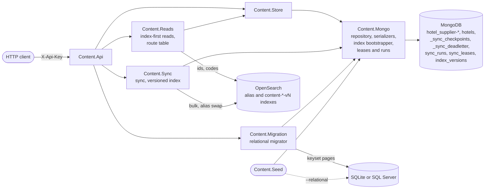
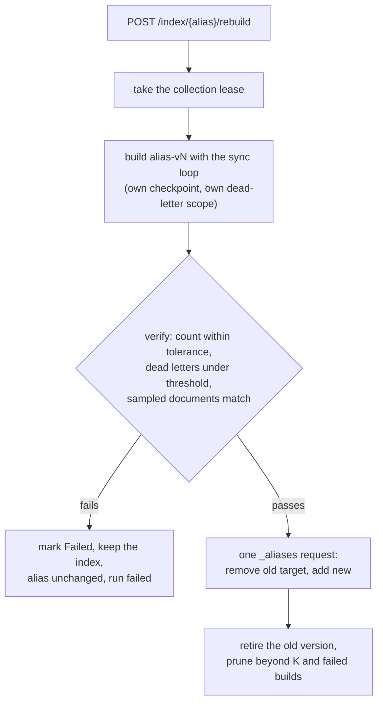
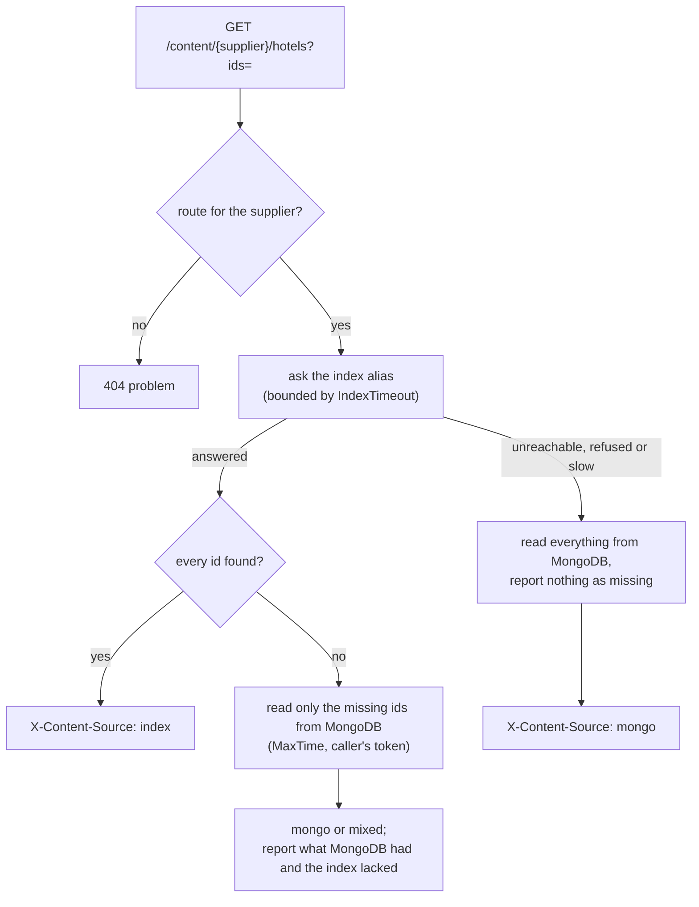

# mongo-content-store

A reference implementation of the read-optimised layer of a hotel static-content platform on MongoDB:
one collection per supplier, tolerant decoding of messy supplier data, fast indexed reads, a
checkpointed, resumable MongoDB to OpenSearch sync that survives crashes without losing or duplicating documents, a
versioned search index that is rebuilt, verified and switched with one alias request, reads that go to the index first
and fall back to MongoDB safely, and (as an extension) a resumable relational-to-MongoDB migrator. All of it sits
behind an HTTP API.

## Why

Supplier content is large (millions of documents per supplier), inconsistent (a rating is `"4.5"`, `4` or `4.5`; images are
strings or objects; an id is a number or a string) and keeps changing. A content layer for it has to be fast to read,
forgiving when it decodes, honest about what it dropped, and able to feed a search index without anyone babysitting the
copy. Each of those is a small, testable piece here rather than a framework.

## Architecture



One sync batch, in the order that makes a crash safe:

```mermaid
sequenceDiagram
    participant R as SyncRunner
    participant M as MongoDB
    participant O as OpenSearch
    R->>M: read page (_id > lastId, limit + 1)
    R->>R: decode each document (bad ones become dead letters)
    R->>O: bulk index in chunks, two in flight
    O-->>R: per-item results (200 can still reject items)
    R->>O: retry 429/503 items once
    R->>M: write dead letters (rejected and undecodable)
    R->>M: save checkpoint (last _id of the batch)
    Note over R,M: a crash before the checkpoint replays the batch;<br/>index ids are source ids, so replays overwrite
```

A rebuild builds a new physical index, judges it, and only then moves the alias (the old index stays for rollback):



A lookup by id asks the index first and treats "missing" as a signal only when the index actually answered:



## Project layout

```
MongoContentStore.slnx
src/
  Content.Mongo      options, shared client, generic repository, tolerant serializers, index bootstrapper,
                     persisted runs and per-target leases
  Content.Store      hotel model, per-supplier collection naming, content store, room mapper registry
  Content.Sync       checkpoint store, scan loop, bulk indexer, dead letters, run workers, versioned index
                     (admin port, verifier, version manager)
  Content.Reads      index-first reads with MongoDB fallback, route table, X-Content-Source
  Content.Migration  relational-to-MongoDB migrator (an extension), row sources, column mapping
  Content.Api        minimal API: auth, problem details, health checks, OpenAPI
tools/
  Content.Seed       synthetic hotel generator with deliberately malformed fields (Bogus); --relational writes a SQLite source
bench/
  Content.Bench      numeric $in versus stringified-id lookups; writes bench/RESULTS.md
tests/
  Content.Tests            unit and API tests over in-memory fakes; needs nothing installed
  Content.TestSupport      fault-injecting search writer, in-memory cluster, lease, run and version stores
docs/
  adr/                     architecture decision records
  openapi.json             generated OpenAPI document, checked by a test
requests/                  .http files, one working request per endpoint
.github/workflows/ci.yml   restore, build with warnings as errors, tests, OpenAPI snapshot check
```

## Run it

The verified path is the test suite (see below): it needs nothing installed. The API cannot serve content without a
real MongoDB, and sync needs a real OpenSearch. To run it against your own instances, point the `Mongo` and `OpenSearch`
settings at them (`appsettings.Development.json` uses `localhost` and carries obviously fake keys) and start it with the
application arguments after `--`:

```bash
dotnet run --project src/Content.Api -- --environment Development --urls http://localhost:5103
```

To fill your own MongoDB with synthetic hotels: `dotnet run --project tools/Content.Seed -c Release -- --count 1000000 --reset`
(`--help` lists the options). To write a SQLite source for the migration demo instead:
`dotnet run --project tools/Content.Seed -- --relational ./demo-source.db --count 5000 --reset`; the Development settings
define a migration, `hotels-from-sqlite`, that reads it into `hotel_supplier-c`. The `requests/*.http` files walk through
every endpoint (VS Code REST Client or Rider).

## API

Versioned under `/api/v1`. Every route except health and OpenAPI needs `X-Api-Key`; the sync, index and migration routes
need an admin key. Errors are RFC 7807 `application/problem+json` and never include stack traces. `X-Correlation-Id` is
accepted (or generated), echoed on the response and added to the log scope.

| Method | Route | Auth | What it does | Statuses |
|---|---|---|---|---|
| GET | `/content/{supplier}/hotels?ids=1,2,3` | key | Hotels by numeric id: search index first, MongoDB completes what is missing. `X-Content-Source` says `index`, `mongo` or `mixed` | 200, 400, 401, 404, 503 |
| GET | `/content/{supplier}/hotels?cityCode=&pageSize=&cursor=` | key | Keyset page of hotel ids for a city, `limit + 1`, returns `nextCursor` (MongoDB) | 200, 400, 401, 404 |
| GET | `/content/{supplier}/hotels/by-code/{code}` | key | Hotel by the supplier's alphanumeric code, index first like the lookup by id | 200, 401, 404, 503 |
| GET | `/content/hotels/search?name=&countryCode=&mode=anchored\|contains\|ci&limit=` | key | Name search on the merged master | 200, 400, 401 |
| GET | `/content/hotels/by-provider/{supplier}/{hotelId}` | key | Merged hotels listing a supplier id (string or number form) | 200, 400, 401 |
| GET | `/content/{supplier}/hotels/{id}/rooms/{roomId}/detail` | key | Room detail from the supplier's room mapper | 200, 401, 404, 422 |
| POST | `/sync/{collection}/runs` | admin | Start or resume a sync (background, one active run per collection across instances) | 202, 400, 401, 403, 404, 409 |
| GET | `/sync/{collection}/status` | admin | State, last checkpointed id, counts, last error; readable from any instance | 200, 401, 403, 404 |
| GET | `/sync/deadletters?collection=&cursor=&pageSize=` | admin | Documents that could not be indexed (or migrated), newest first, keyset paging via `nextCursor` | 200, 400, 401, 403 |
| POST | `/sync/{collection}/cancel` | admin | Stop the active run; the checkpoint stays at the last completed batch | 202, 401, 403, 404, 409 |
| POST | `/index/{alias}/rebuild` | admin | Build a new versioned index, verify it, switch the alias (uses the collection's run lease) | 202, 400, 401, 403, 404, 409 |
| GET | `/index/{alias}` | admin | Versions, the current one, the retained ones, the last verification, the latest run | 200, 401, 403, 404 |
| POST | `/index/{alias}/rollback` | admin | Point the alias back at a retained version | 200, 400, 401, 403, 404, 409 |
| POST | `/migration/runs` | admin | Start or resume a configured relational-to-MongoDB migration by name | 202, 400, 401, 403, 404, 409 |
| GET | `/migration/runs/{id}` | admin | State, progress, last key, error and the count verification | 200, 401, 403, 404 |
| POST | `/migration/runs/{id}/cancel` | admin | Stop an active migration run; its checkpoint stays | 202, 401, 403, 404, 409 |
| GET | `/health/live` | none | Process is up | 200 |
| GET | `/health/ready` | none | MongoDB and OpenSearch both answer | 200, 503 |
| GET | `/openapi/v1.json` | none | Generated OpenAPI document | 200 |

Name search modes: `anchored` is a case-sensitive prefix match that can use an index; `contains` is a case-insensitive
substring match that scans the collection (a documented trade-off, so treat it as a fallback); `ci` is a case-insensitive
whole-name match answered by a collation index (`en`, strength 2). Collections in the sync routes are `hotels` and
`hotel_{supplierKey}`; the alias of a collection is `content-{collection}`.

### Configuration

Settings come from `appsettings.json` and environment variables (`Section__Key`). Options are validated at startup and the
host refuses to start on a bad value.

| Setting | Default | Notes |
|---|---|---|
| `Mongo:ConnectionString`, `Mongo:DefaultDatabase` | required | A connection string that sets `socketTimeoutMS` is rejected (ADR 6) |
| `Mongo:ConnectTimeout`, `Mongo:ServerSelectionTimeout` | 5 s | |
| `Mongo:MaxConnectionPoolSize` | 100 | |
| `Mongo:BootstrapIndexes` | `true` | Ensures every declared index at startup |
| `ContentStore:Suppliers` | `supplier-a`, `supplier-b`, `supplier-c` | A new supplier is a new entry here (and a route), not code |
| `ContentStore:ReadMaxTime` | 5 s | Server-side time limit on lookups by id and code, including the fallback |
| `Reads:Routes` | one per supplier | Supplier, collection and index alias; validated at startup (ADR 8) |
| `Reads:IndexTimeout` | 1 s | A slower index is treated as not answering |
| `OpenSearch:Uri`, `OpenSearch:IndexPrefix`, `OpenSearch:Replicas` | required, `content-`, 0 | |
| `Sync:BatchSize` | 5000 | Per-run override via the start request |
| `Sync:BulkChunkSize`, `Sync:BulkMaxParallelism` | 500, 2 | |
| `Sync:MaxReadAttempts`, `Sync:ReadBackoffCap` | 5, 60 s | Exponential backoff, always cancellable |
| `Coordination:LeaseDuration`, `Coordination:HeartbeatInterval` | 30 s, 10 s | Heartbeat at most half the lease |
| `IndexVersioning:RetainedVersions` | 2 | Previous versions kept for rollback |
| `IndexVersioning:CountTolerance`, `MaxDeadLetters`, `SampleSize` | 0.001, 100, 25 | How a new index is judged before the swap |
| `Migration:Definitions` | none | Source, query, key, column mapping, target; connection strings belong in environment variables |
| `Auth:ApiKeys`, `Auth:AdminKeys` | required (admin) | At least 16 characters, compared in constant time |

## Tests

```bash
dotnet build -warnaserror
dotnet test
```

`dotnet test` runs through Microsoft.Testing.Platform (selected in `global.json`), which is what xUnit v3 needs on the .NET 10
SDK. Every test runs in process over in-memory fakes behind the existing ports (a fake search cluster with fault injection,
in-memory checkpoint, dead-letter, lease, run and version stores, a fake source reader and migration target), SQLite for the
relational migrator, and `WebApplicationFactory` for the API (substitutes for the contract tests; the real coordinators,
runner and workers over the in-memory stores for the flows). Nothing needs MongoDB, OpenSearch or a SQL Server.

The generated OpenAPI document is committed as `docs/openapi.json`, and a test fails when the API surface changes without it.
Regenerate it with:

```bash
UPDATE_OPENAPI=1 dotnet test --project tests/Content.Tests --filter "FullyQualifiedName~OpenApiSnapshotTests"
```

(PowerShell: `$env:UPDATE_OPENAPI=1; dotnet test --project tests/Content.Tests --filter "FullyQualifiedName~OpenApiSnapshotTests"`.)

### What is proven where

Each claim below is backed by the listed test classes, which run in `dotnet test`. "Not proven here" says what a fake cannot
show; those points are collected under Known limits.

| Claim | Tests | Not proven here |
|---|---|---|
| Numeric `$in` on the id, never a stringified comparison | `HotelContentStoreTests` render the filter and assert `Int64` values and no `$expr` | That the server answers it from the `_id` index (see the benchmark) |
| Tolerant serializers: a bad value drops that field, never the document | `StringOrNumberSerializerTests`, `TolerantStringListSerializerTests`, `ImageUrlListSerializerTests`, `TolerantDoubleSerializerTests`, `ScalarObjectSerializerTests`, `TolerantStringMapSerializerTests`, `TolerantDocumentSerializerTests`, `HotelDocumentDecodingTests` (a document with every defect), `SyncDocumentTests` (messy documents through a sync) | |
| Collation index declaration and query shape | `HotelIndexProviderTests` (the `en`, strength 2 index on name and city), `HotelContentStoreTests` (the collation equality query) | That the query uses the index and that anchored regexes get tight bounds |
| Crash and resume loses nothing and duplicates nothing | `SyncRunnerTests`, `SyncResilienceTests`, `SyncFlowTests` (over HTTP), `IndexVersionManagerTests` (a rebuild), `MigrationRunnerTests`, `SqliteMigrationTests`, `MigrationFlowTests` | |
| Bulk rejections, dead letters and the checkpoint order | `SyncRunnerTests` (ordered operation log), `BulkIndexerTests`, `SyncFlowTests` (keyset listing), `DeadLetterCursorTests` | How a real cluster reports per-item rejections |
| A retryable rejection aborts the run with the checkpoint held (ADR 4) | `SyncRunnerTests`, `BulkIndexerTests` | |
| Index creation is retried, bounded and cancellable | `IndexCreationRetryTests`, `SyncResilienceTests` | |
| Two collections sync in parallel, failures aggregate | `SyncParallelTests`, `SyncRunnerCollisionTests` (ids that a lossy conversion would merge stay distinct) | |
| Lease race, expiry hand-over, heartbeat, status from any instance | `LeaseCoordinationTests`, `SyncCoordinatorTests`, `SyncFlowTests` (two API instances) | The `findOneAndUpdate` itself on a server |
| Alias swap is one request with remove and add together; readers never see a missing alias; failed verification keeps the alias; rollback; prune keeps K; rebuild resumes | `IndexVersionManagerTests` (including a concurrent reader loop over the in-memory cluster), `IndexFlowTests` (over HTTP) | Atomicity of `_aliases` on a real cluster |
| Index-first reads, partial-hit completion, same response shape | `ContentReaderTests`, `ReadFlowTests` (one hotel served both ways, bodies compared), `SearchDocumentRoundTripTests` | |
| Fallback guard: "missing" counts only when the index answered; outage and timeout record nothing; a client abort is not a slow index; `MaxTime` on the fallback | `ContentReaderTests`, `ReadFlowTests`, `HotelContentStoreTests` (the time limit is passed) | That the server enforces `MaxTime` |
| Route table validation at startup, completeness over the configured suppliers | `ReadRouteRulesTests`, `ReadRouteTableTests`, `ReadRouteStartupTests` (the host refuses to start) | |
| `X-Content-Source` values | `ContentReaderTests`, `ReadFlowTests` | |
| Migrator: keyset pages over a reader, idempotent, resume, dead letters, count verification, bounded pages | `DbRowSourceTests` (SQLite), `RowMapperTests`, `MigrationRunnerTests`, `SqliteMigrationTests`, `MigrationFlowTests`, `MigrationOptionsTests`, `DemoDefinitionTests` | The upsert and count on a real MongoDB; SQL Server is covered by dialect and connection-type tests only |
| API contract, auth, problem details, health, correlation id, OpenAPI | `ApiContractTests`, `OpenApiSnapshotTests` | |

## Design decisions

Short records in [`docs/adr`](docs/adr):

1. [One collection per supplier](docs/adr/0001-collection-per-supplier.md) rather than one polymorphic collection.
2. [Numeric `$in` on `_id`](docs/adr/0002-numeric-in-versus-string-conversion.md), never a stringified comparison.
3. [Tolerant serializers](docs/adr/0003-tolerant-serializers.md): a bad value drops that field, never the document.
4. [Keyset checkpointing, dead letters and idempotent upserts](docs/adr/0004-keyset-checkpointing-dead-letters-idempotent-upserts.md), including why a retryable rejection aborts the run and what an operator does next.
5. [Flat `ProviderKeys`](docs/adr/0005-flat-provider-keys.md) instead of a `nested` mapping.
6. [No long socket timeouts](docs/adr/0006-no-long-socket-timeouts.md).
7. [Versioned index, one-request alias swap, verification and rollback](docs/adr/0007-versioned-index-alias-swap-and-rollback.md).
8. [Search-index-first reads, the fallback guard and the route table](docs/adr/0008-search-first-reads-fallback-guard-and-route-table.md).
9. [Persisted runs with a per-target lease](docs/adr/0009-lease-based-run-coordination.md).
10. [The relational-to-MongoDB migrator](docs/adr/0010-relational-to-mongo-migrator.md), labelled as an extension.

## Benchmark

`bench/Content.Bench` compares the two ways of asking for 100 hotels by id on 200,000 seeded hotels in one supplier collection
(a local MongoDB 8.0.38 server, .NET 10, 12 logical cores; 3 warm-up runs, 20 measured runs, projection `{ _id: 1 }`).
These numbers are from one earlier run on one machine; the benchmark is not part of `dotnet test` and was not re-run for the current commit. The full table is in [`bench/RESULTS.md`](bench/RESULTS.md).

| Query | Median | p95 | Keys examined | Documents examined | Plan |
|---|---:|---:|---:|---:|---|
| numeric `$in` on `_id` | 4.80 ms | 16.07 ms | 200 | 0 | covered index scan |
| stringified id (`$expr` with `$toString`) | 986.47 ms | 1704.69 ms | 0 | 200,000 | collection scan |

Reproduce it with `dotnet run --project tools/Content.Seed -c Release -- --suppliers supplier-a --count 200000 --reset` followed by
`dotnet run --project bench/Content.Bench -c Release` (`--help` lists the options for the connection, collection and sizes).

## Known limits

Unverified here, because no test starts a MongoDB, OpenSearch or SQL Server (everything runs over in-memory fakes or SQLite):

- How the real servers answer: that the numeric `$in` is an `_id` index scan and the stringified form a collection scan (the
  benchmark measured this once, see above), that the declared indexes exist and the collation query uses its index, that an
  anchored regex gets tight index bounds, and the `$elemMatch` provider query.
- `MongoRepository` against a live server: streaming batch size, cursor cancellation, bulk upsert, counts.
- The OpenSearch index mapping as the cluster accepts it (the tests assert the JSON the mapping produces, including the
  disabled `rooms` and `providers` objects), bulk-API per-item semantics (a 200 that rejects items), and how a real cluster
  reports transient rejections.
- Atomicity of the alias change on a real cluster. The tests prove the code sends one `_aliases` request with the removal and
  the addition together, and that readers of the in-memory cluster never see a gap; the cluster's own guarantee is not exercised.
  The OpenSearch client calls behind the index-admin port (alias lookup, `remove_index` plus add, multi-get, count, listing)
  are not run against a cluster either.
- The shape of the documents written to `_sync_checkpoints`, `_sync_deadletter`, `sync_runs`, `sync_leases` and
  `index_versions`, and the atomic `findOneAndUpdate` that takes a lease: the logic is tested against in-memory stores with the
  same semantics, not the server operation itself. Instances need clocks that agree well within the lease duration.
- The migrator's upsert and exact count on MongoDB, and the SQL Server provider beyond its generated SQL and connection type.
- A dropped malformed field is indistinguishable from an absent one in the model (a rating becomes `0`), although every drop is
  counted by the `content.mongo.malformed_fields` metric.
- The read path only counts the keys the index lacked (`content.reads.index_misses`); nothing consumes them to trigger a resync.
- A hotel with only one of latitude and longitude loses both in the index (they are indexed as a pair), so a read served by the
  index differs from the MongoDB one for such a hotel. Room detail always reads MongoDB, because the index does not keep the
  free-form room attributes.
- The migrator is an extension added to round out the migration story; it is exercised end to end only against SQLite.

## Roadmap

Not built:

- A consumer that resyncs the keys the read path reported as missing from the index.
- Running the proofs above against real MongoDB and OpenSearch instances.
- City paging and name search from the search index.

## License

MIT, see [LICENSE](LICENSE).
